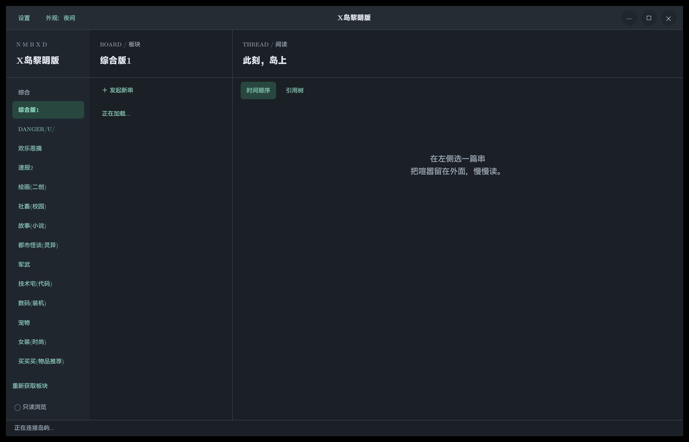
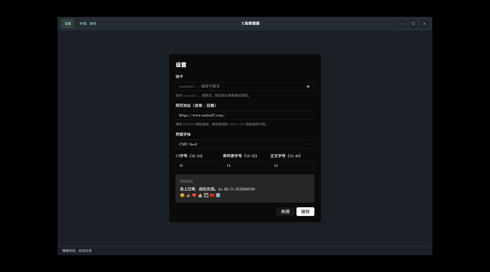

# R岛 · rdnmb

Rust / GPUI 原生 X 岛客户端。支持跟随系统 / 浅色 / 深色主题，使用客户端标题栏（CSD），提供拖动、双击最大化，以及最小化、最大化和关闭按钮。四栏布局：板块 → 串列表 → 阅读 → 发串 / 回复；拖动栏间分隔线可调整宽度，各栏保留最小宽度。打开串渐显，编辑栏展开动画。中文输入、选择和剪贴板由 gpui-component 输入组件提供。

## 运行（Fedora toolbox）

```sh
toolbox run cargo run --locked
```

首次编译较大。需要 Rust 工具链、Wayland / X11 开发库、Vulkan 驱动和中文字体。如缺少系统库，可在 toolbox 安装：

```sh
toolbox run sudo dnf install -y gcc-c++ cmake clang pkgconf-pkg-config \
  libxkbcommon-devel libxkbcommon-x11-devel wayland-devel \
  fontconfig-devel freetype-devel libxcb-devel openssl-devel \
  vulkan-loader mesa-vulkan-drivers google-noto-sans-cjk-fonts
```

未保存界面设置时，从项目目录启动会读取 `.env`。优先使用 `RDNMB_COOKIE`，兼容旧变量 `NMBXD_COOKIE`、`userhash` 或现有文件使用的 `usrhash`，值为原始百分号编码饼干；也支持 `userhash=…` 形式。无饼干可尝试只读浏览，具体可见板块由服务器决定。`.env` 已忽略，不要提交真实凭据。

```sh
toolbox run cargo test --locked
toolbox run cargo run --locked -- --smoke
```

`--smoke` 只读请求板块列表、综合一首页和其中一串第一页；不输出凭据或帖子内容，不发送帖子。

主题按钮循环切换跟随系统、浅色和深色，选择保存到 `$XDG_CONFIG_HOME/rdnmb/appearance.json`（默认 `~/.config/rdnmb/appearance.json`），首次启动跟随系统。

## 设置

标题栏“设置”可修改 cookie、订阅 ID、网页地址、界面字体，以及 UI / 串列表 / 正文三个独立字号（默认 16 / 14 / 14 px；编辑框正文跟随正文字号）。保存后即时生效，重启后保留。网页地址默认 `https://www.nmbxd1.com/`，也可输入 `www.nmbxd1.com`；只接受 HTTPS 站点根地址，用于发串 / 回复，JSON 浏览 API 的地址独立。旧设置会自动采用新默认值。cookie 默认隐藏，可临时显示；清空并保存后以游客身份请求，不会重新采用 `.env` 中的旧 cookie。字体下拉框列出系统安装的字体，支持搜索和预览；保存后应用到整个界面，包括编辑器，切换主题仍保留字体选择。

设置保存在 `$XDG_CONFIG_HOME/rdnmb/settings.json`（默认 `~/.config/rdnmb/settings.json`），优先于启动环境和 `.env`。启动时会自动将旧 `nmbxd/settings.json` 复制到新目录，保留 cookie、订阅 ID、字体和字号；新目录没有 `appearance.json` 时先读取旧目录中的主题，下次保存主题时写入新目录。已有新目录文件时优先使用新文件，旧文件仍保留。Linux 文件权限为 `0600`，使用临时文件原子替换。cookie 是本地明文保存，不是密钥环存储；分发包绝不包含该文件。保存先检查 cookie 格式，再替换网络客户端；服务器是否接受该饼干以实际请求为准。不会通过发帖验证饼干。

## 阅读与引用树

第二栏顶部“刷新”重新请求当前板块第一页，检查最新串；不会关闭正在阅读的串或清空编辑器草稿。

- 初始只读取串第一页。阅读区顶部显示当前页 / 总页数，可上一页、下一页或输入页码跳转，不必滚动到末尾。
- 跳页成功后，以目标页作为新的已加载子集；失败则保留原内容。时间顺序只显示当前页，切换引用树则聚合这个子集。树模式可手动向前 / 向后各加载一页 buffer，并显示已加载页范围；不追踪引用抓取，也没有自动轮询。
- 串列表与回复区向下滚到底时自动加载一页；引用树向已加载范围后方扩展。只有用户滚动触发，不因窗口变大或短页内容自动连续抓取。失败后停止自动重试，显示手动重试。
- “已到底”仍可点击“刷新，检查新回复”：重新请求当前页（树模式为缓冲区末页），更新总页数且保留当前子集；有新页后可以继续加载。板块末尾也可重新检查下一页。
- HTTP 在独立线程串行执行，请求结束后间隔至少 800ms；页加载按钮有进行中保护。当前子集已加载页面留在内存里，切换缓存页无需再次请求。
- 切换“时间顺序 / 引用树”不产生网络请求。引用树从正文提取 `>>No.123` / `>>123`，保留多个引用，选择第一个已知且不会成环的引用作为父节点；其他回复归到主串下。
- 未加载 / 串外引用明确标注；不会假装已知其属于当前串。新页面加载后重新组织树，去重并阻止循环引用。分支可折叠，视觉缩进最多七层。
- “刷新”成功后重新从第一页建立子集，适用于读取新回复或核实发送结果；失败则保留原内容。

## 图片与 emoji

帖子与串列表显示图片缩略图，点击正文图片可在客户端查看原图；图片失败可点击重试。只有进入可视区域的图片才排队加载，原图需主动点击。图片请求不带饼干，不跟随重定向；限制并发、下载大小和解码像素数，使用有上限的会话内存缓存。正文中的任意 HTML 外链图片不会自动加载。

内置 Noto Color Emoji 位图字体，供 Unicode emoji 的字体回退使用，不改变选择的正文 / 编辑器字体。支持字体所包含的 emoji；新版本 Unicode 或复杂组合的显示仍取决于字体与 GPUI 的 shaping 支持。字体许可证随发行包附带。

## 发串与回复

点“发起新串”或“回复”打开编辑栏；引用回复自动插入引用号。发送目标固定显示在编辑栏标题中，有内容的草稿不会因切换阅读目标而被转发到别处。收起编辑器保留当前会话草稿，清空或发送成功后才可改换目标。发送进行中禁止编辑与重复点击。

旧网页域名的跳转会导致发帖失败，请在设置中检查网页地址。遇到 3xx 会提示状态和跳转目标，但不会自动携带饼干向新站点重放 POST。

编辑栏支持一张图片附件：点击“选择图片”，或从剪贴板粘贴图片（编辑框内 Ctrl+V / macOS Cmd+V，也可点“粘贴图片”）。选中后显示预览，可移除或替换。图片可以不附正文，失败时保留文字和附件；收起编辑器也保留草稿，清空或发送成功才移除附件。

Linux 文件选择直接使用 XDG Desktop Portal（ashpd），不会静默回退到外部选择器；需要运行 `xdg-desktop-portal` 和桌面对应后端。使用 portal 授权返回的文件路径，兼容后续 Flatpak 文档门户；当前发布包还不是 Flatpak。非 Linux 使用 rfd 原生选择器，Windows/macOS 尚未实机验证。

上传支持 JPEG / PNG / GIF，客户端限制 10 MiB，并对图片解码尺寸设限；服务器可能有更严格限制。文件上传保留原始内容，GIF 附件保留动画（客户端预览仍为首帧）；其他剪贴板位图格式转换为 PNG。只在点击发送时上传，选择 / 粘贴不会发送内容。

点击“发送”会真实提交。成功必须由服务器明确返回成功标记；网络错误或不明返回保留草稿，且不会自动重试。请先刷新确认，避免重复发帖。

## 当前边界

这是可继续迭代的文本客户端基础版本。图片支持 JPEG / PNG / GIF / WebP（动图暂显示首帧），尚未实现收藏、时间线、离线缓存和跨重启草稿保存；HTML 转为纯文本，不执行页面脚本。没有自动把整串抓完，仅按用户滚动或手动操作逐页加载。所有已加载回复目前使用普通滚动容器，超长串的列表虚拟化仍需后续实现。

依赖固定为 GPUI 0.2.2 / gpui-component 0.5.1。`vendor/` 保留两个小补丁：cosmic-text 的完整 emoji 字符簇字体选择，以及 gpui-component 最大化 / 平铺时的窗口缩放命中区域（使用当前 viewport 而非还原尺寸）；详情见各目录 `NMBXD-PATCH.md`。保留 Cargo.lock：旧 xattr 0.2 的 Linux ENOATTR 引用与最新 libc 不兼容，因此锁文件使用 libc 0.2.186。

API 依据 [TransparentLC/xdcmd 的文档](https://github.com/TransparentLC/xdcmd/wiki/自己整理的-X-岛匿名版-API-文档)，界面基于 [GPUI](https://gpui.rs/)。

## Linux 发布包

构建并打包当前主机架构：

```sh
scripts/package-linux.sh
# 在 Fedora toolbox 中构建、打包：
toolbox run scripts/package-linux.sh
# 已完成 release 构建时：
scripts/package-linux.sh --skip-build
```

输出位于 `dist/rdnmb-版本-linux-架构/`，以及同名 `.tar.gz` 和 `.tar.gz.sha256`。压缩包只包含程序、图标、桌面入口、说明、安装 / 卸载脚本、空白凭据示例和构建环境记录，不包含真实 `.env`、帖子数据或整个 `target`。`SOURCE_DATE_EPOCH` 可指定归档时间，默认使用最近一次提交时间；归档文件顺序和元数据固定。二进制本身的可重现性仍取决于工具链和系统库。

解压后可直接运行 `./rdnmb`，或在解压目录执行 `./install.sh`，安装到当前用户的 `~/.local/bin` 及应用菜单。无需 sudo。应用 ID 为 `org.niconi.rdnmb`，桌面文件名为 `org.niconi.rdnmb.desktop`。从旧版升级时，请先在旧发行包目录运行旧版 `./uninstall.sh`，再安装新版；新版安装器保留旧 `nmbxd` 程序、桌面入口和图标，不会自动删除它们。执行新版 `./uninstall.sh` 删除这些安装文件；不会删除用户凭据。通过菜单启动后可以直接在标题栏的“设置”中填写饼干；从终端启动时也可以使用环境变量或当前目录的 `.env`。

```sh
sha256sum -c rdnmb-版本-linux-架构.tar.gz.sha256
tar -xzf rdnmb-版本-linux-架构.tar.gz
cd rdnmb-版本-linux-架构
./rdnmb
```

这是针对构建机器架构的动态链接 Linux 程序，尚未提供 AppImage、Flatpak 或跨发行版静态包。构建环境写入 `BUILD-OS.txt`，实际 `ldd` 输出写入 `DEPENDENCIES.txt`；打包遇到缺失库会失败。较新 Fedora 编译的程序可能要求较新的 glibc，不能保证在较旧 Ubuntu / Debian 等发行版运行。分发前应在目标发行版运行 `ldd ./rdnmb` 检查 `not found` / GLIBC 版本错误，并验证桌面启动。运行需要可用的 Wayland / X11 图形会话、图形驱动及中文字体。

## Windows 测试包

Windows CI 使用 `x86_64-pc-windows-msvc`，生成 `rdnmb-版本-windows-x86_64.zip` 和对应 `.zip.sha256`，随 tag 的 Linux 包一起发布。解压整个 ZIP 后运行其中的 `rdnmb.exe`；包内附带说明和许可证。release 版本使用 Windows GUI 子系统，启动时不保留控制台窗口。

在 Windows PowerShell 中可用 `Get-FileHash .\rdnmb-版本-windows-x86_64.zip -Algorithm SHA256` 核对校验文件。本机构建和打包可运行 `./scripts/package-windows.ps1`，已有对应 target 的 release 构建时加 `-SkipBuild`。构建需 Rust MSVC 工具链、Visual Studio C++ Build Tools 和 Windows SDK；GPUI 的 release 着色器编译需要 `fxc.exe`，可通过 `GPUI_FXC_PATH` 指定完整路径，CI 会自动查找。

Windows 配置默认保存在 `%APPDATA%\rdnmb\settings.json` 和 `appearance.json`，也支持以绝对路径的 `XDG_CONFIG_HOME` 覆盖。虚拟机中的窗口渲染、中文输入、图片剪贴板和文件选择仍待实机验证；CI 仅构建及运行单元测试，不启动 GUI。

## 验证记录

已在 Fedora 45 toolbox 完成 release 构建、83 项应用单元测试，另有 8 项 cosmic-text 测试、2 项窗口边缘回归测试和 `cargo clippy --all-targets -- -D warnings`。已检查 GNOME 下的 CSD 窗口和 Wayland 启动，以及夜间主题、系统字体下拉搜索、字体切换保存和设置文件 `0600` 权限。已在隔离 X11 / CSD 会话检查分隔线拖动、图片缩略图与原图、emoji 组合、Ctrl+V 图片草稿预览、自动翻页、末页刷新，以及最大化后关闭原图。Linux FileChooser portal 服务版本检查通过；尚未完成跨平台原生文件选择器实机测试。只读 API smoke 验证板块、串列表、回复页；未发送测试帖子。中文 IME 的实际输入仍需在桌面输入法环境中确认。

以下截图来自更名前的旧版，展示夜间模式、客户端标题栏及设置界面。




### 引用预览与外部链接

正文中的 `>>No.123`、`>>123`、`No.123` 和岛内串链接可点击预览；预览内的引用可以继续打开，支持逐层返回和关闭全部。循环引用返回已打开的层级，最多嵌套 32 层。已加载的消息直接复用，不主动预取引用或扫描页面。

“跳转到串”打开对应主串；已确认属于当前串的消息显示“已在当前串”，点击完全不改变阅读页码、位置和草稿。引用 API 不提供所属主串编号：未知引用只在点击跳转时尝试确认其是否为主串；串外回复不能定位时会明确提示，仍可阅读预览。

HTTP(S) 外链通过系统默认浏览器打开，保留 HTML 链接的目标地址；拒绝 javascript / data / file 等协议。

原图和引用预览支持 **Esc** 或鼠标后退键关闭；嵌套引用每次只返回一层，其他页面不拦截这些按键。

### 服务器订阅 / 收藏夹

- 左侧“☆ 我的订阅”读取岛上的订阅列表，支持刷新、滚动分页及失败后手动重试。
- 阅读区工具栏“☆ 添加订阅”收藏当前主串；已知订阅显示“已订阅 · 移除”。订阅列表每项有“移除订阅”，也可右键菜单操作。移除后保留当前阅读内容与草稿。
- 设置中的订阅 ID 默认生成随机 UUID v4，首次运行和旧配置迁移时即保存；重启不会变。不同设备填写相同 ID 可共享。切换 ID 不删除原订阅。
- **知道订阅 ID 的人可以查看和修改这份订阅**，请妥善保存；它独立于 cookie，使用订阅不需要发帖饼干。
- API 没有单串订阅状态查询；仅使用已加载订阅页和本次成功操作判断“已订阅”，不为了检查状态拉取整个收藏夹。未知状态允许直接添加，服务器重复添加不产生重复收藏。共享列表在其他设备变化后请刷新。
- 订阅读写和错误处理已用本地 HTTP 模拟服务测试，未更改真实服务器订阅；另已只读验证随机 ID 的空订阅列表。隔离 X11 会话已验证嵌套预览、Esc / 鼠标后退逐层关闭、原图 Esc 关闭和订阅设置界面。

## GitHub Actions 构建与发布

[构建记录与下载](https://github.com/karuboniru/nmbxd.rs/actions/workflows/build.yml) · [正式发布](https://github.com/karuboniru/nmbxd.rs/releases)

- 每次向任意分支 push、推送 tag，以及 PR 更新，自动在 **Ubuntu 24.04 x86_64** 和 **Windows Server 2022 x86_64（MSVC）** 上运行单元测试、构建 release 并打包。也可在 Actions 页面手动运行。一次 push 多个提交时构建该 push 的最终提交；不取消旧构建。
- 成功后，在该次运行页面的 **Artifacts** 下载 `rdnmb-linux-x86_64-提交SHA`，内含 `.tar.gz` 和 `.sha256`；Windows 下载 `rdnmb-windows-x86_64-提交SHA`，内含 Windows ZIP 包和 `.sha256`。两者保留 30 天。GitHub 的 artifact 下载外层是 ZIP，解开后再解压里面的 tar 包并运行安装脚本。
- 推送任意 tag 时，等待两个平台构建成功后，两份已测试产物自动上传到该 tag 的 **GitHub Release**，不必从 Actions 下载。不会自动创建 tag；手动运行 tag 工作流不会额外发布 Release。重跑 tag 构建会更新该 Release 的同名附件。
- 推荐先更新 `Cargo.toml` / `Cargo.lock` 版本并提交，再执行 `git tag v0.1.6 && git push origin v0.1.6`（版本号按实际填写）。压缩包名使用 Cargo 版本，Release 名使用 tag。
- 构建只使用仓库源码，不需要配置 cookie 或任何自定义 secret；仅发布 job 使用 GitHub 自动提供的 `GITHUB_TOKEN` 写入 Release。PR job 没有仓库写权限。
- Ubuntu 产物仍是动态链接程序，不是通用静态包；运行目标需有兼容的 glibc / 系统库。包内 `BUILD-OS.txt` 与 `DEPENDENCIES.txt` 可用于检查。不在 CI 中启动 GUI，也不向岛上发送内容。

### 复制文字、图片与另存为（v0.1.4）

- 阅读正文和引用预览可鼠标拖选，`Ctrl+C`（macOS `Cmd+C`）复制选中文字，`Ctrl+A` / `Cmd+A` 选择该条消息的全部正文；也可点“复制正文”。链接仍可点击，拖选链接文字不会打开它。
- 正文图片、引用预览图片和原图界面提供“复制图片”和“图片另存为…”。复制使用原图首帧并转换为 PNG，便于粘贴到其他应用；下载保存原始字节，保留 GIF 动画。
- 另存为先准备图片，再弹出系统保存对话框确认文件名和路径；Linux 严格使用 FileChooser portal，Windows/macOS 使用原生保存对话框。取消不写文件，现有文件不会被覆盖，请选择新名称。
- 复制/下载沿用图片来源、12 MiB 响应体、解码尺寸与并发限制，不发送 cookie，不影响发帖草稿；错误显示在状态栏。文件写入失败时会明确提示，目标文件可能不完整。

已在隔离 X11 会话实测拖选复制正文，并使用外部程序读取图片剪贴板的 PNG；原生保存对话框尚待桌面实机验证。

图片复制使用 arboard 原生剪贴板。Linux 优先使用 Wayland data-control，不支持该协议的桌面（如 GNOME）需要可用的 XWayland；失败会显示错误，可改用“图片另存为”。退出应用后图片是否保留取决于桌面剪贴板管理器。

### 发帖／回复颜文字选择器（v0.1.5）

编辑栏点击“颜文字”展开可滚动列表，选择后插入正文光标处（有选中文字时替换选区），自动收起并返回正文输入；支持撤销，Esc 可收起列表，发送中不可修改。

列表是 2026-10-23 网页快照，同时合并 [h.desktop.js](https://www.nmbxd1.com/Public/Js/h.desktop.js) 的 87 项与 [串页面 HTML](https://www.nmbxd1.com/t/69665764) 内联补丁的 12 项及 5 个命名选项，共 104 项（不含空值“无”）。保留原始顺序、换行和特殊空格；离线可用，不在每次打开选择器时请求服务器。定义与回归测试位于 `src/kaomoji.rs`。

### 独立回复草稿（v0.1.5）

回复草稿按主串号分别保留，新串草稿按板块保留（仅当前运行，不写磁盘）。切到其他串会收起旧目标编辑器；点击新目标的“回复”会打开对应草稿，文字、标题、图片与撤销历史不会从旧串带入。未完成的图片读取在切换草稿时作废，避免图片加入错误目标。编辑器标题显示回复串号，发送前再次校验当前目标；清空或发送成功只清理当前草稿。

引用回复在空草稿中直接写入 `>>No.串号`，光标落在下一行；已有正文时只补必要的分隔换行，并保留撤销历史。正文显示将 `<br>` 后用于 HTML 格式的单个源码换行视为同一次换行，不再重复生成空行；连续 `<br>` 表示的主动空行仍保留。

### R岛更名（v0.1.6）

客户端名称改为 **R岛**，包名改为 `rdnmb`，可执行文件和进程名在 Linux 为 `rdnmb`、Windows 为 `rdnmb.exe`，应用 ID 改为 `org.niconi.rdnmb`。新版配置使用 `rdnmb` 目录：自动复制旧设置，旧主题在读取后于下次保存时写入新目录；已有新文件时优先使用新文件。环境变量推荐 `RDNMB_COOKIE`，继续兼容 `NMBXD_COOKIE`。岛站域名和本项目 GitHub 仓库地址保持原样。
