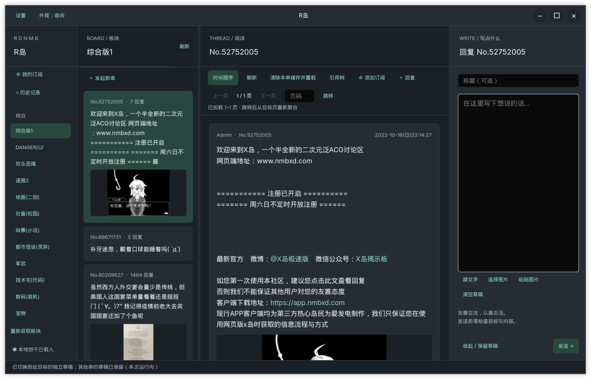

# R岛 · rdnmb

**R岛是 X 岛（nmbxd.com）的第三方桌面客户端，支持 Linux 和 Windows。**

使用 **Rust + GPUI / gpui-component** 构建原生界面，基于 **reqwest** 访问 API，使用 **SQLite** 保存本地历史与阅读缓存。

[下载发布版](https://github.com/karuboniru/nmbxd.rs/releases) · [Actions 测试构建](https://github.com/karuboniru/nmbxd.rs/actions/workflows/build.yml)

## 已实现功能

- **浏览与阅读**：板块和串列表、滚动分页、页码跳转、时间顺序 / 引用树切换、嵌套引用预览。
- **发串与回复**：引用回复、图片附件与剪贴板粘贴、颜文字选择器；按串或板块独立保留本次运行中的草稿。
- **图片与复制**：缩略图、原图查看、图片复制与另存为、正文选择与复制、emoji 显示。
- **订阅收藏**：查看、添加和移除服务器订阅，通过订阅 ID 在设备间共享。
- **历史与缓存**：浏览 / 发串 / 回复历史、阅读位置恢复、已缓存内容离线阅读、图片磁盘缓存。
- **界面设置**：跟随系统 / 浅色 / 深色主题，可调整栏宽、字体和字号。

## 发串前配置 Cookie

**发串和回复需要有效的 X 岛 Cookie（饼干）。** 在浏览器打开已配置饼干的 X 岛网页，按 **F12** 打开开发者工具，在“应用 / 存储 → Cookies”中找到当前站点的 `userhash`，复制其原始值（保留百分号编码），填入客户端“设置”中的 Cookie 并保存；也可填写 `userhash=…`。

未配置 Cookie 时可尝试只读浏览，可访问板块由服务器决定。Cookie 是发帖凭据，请勿分享或提交到仓库；客户端会将其明文保存在本地设置文件中。

## 文档

- [Linux 构建、运行与打包](docs/build-linux.md)
- [Windows 构建、运行与打包](docs/build-windows.md)
- [GitHub Actions 与发布流程](docs/ci.md)
- [使用说明与功能细节](docs/usage.md)
- [技术说明、限制与验证记录](docs/technical.md)

界面截图：

